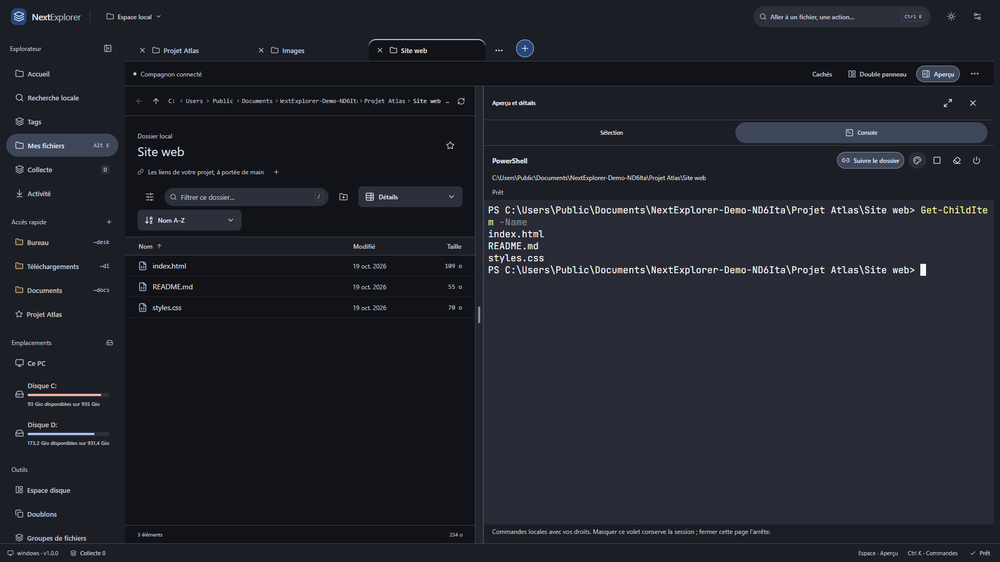

# Fonctions de NextExplorer

Ce guide décrit la préversion technique gratuite.
[Télécharger](https://github.com/Gremy44/NextExplorer-Downloads/releases)
· [Installer](INSTALLATION.md) · [Présentation](README.md)

## Deux façons de travailler dans Chrome

**Panneau latéral :** gardez la page web visible et naviguez dans vos fichiers
à côté. Les vues Fichiers, Page et Collecte séparent la navigation locale,
les actions liées au site et les éléments réunis pour votre travail.
Chemin, retour, remontée de dossier, recherche, affichage, tri et filtres
restent disponibles. Agrandir ouvre la vue complète.

**Vue complète :** plusieurs onglets de dossiers et un double panneau ajustable
permettent de travailler sur plusieurs emplacements. Navigation, activité et
aperçu ont des largeurs réglables.

## Du dossier à la page web

Maintenez le **nom d’un fichier ordinaire** dans Fichiers ou Collecte, puis
glissez-le vers le site. Aucun ajout préalable à la collecte ni case à cocher
n’est nécessaire. Le fichier reste à sa place.

Ce geste Windows concerne un fichier par geste à la souris, sans dossiers ni
liens symboliques. Le site doit accepter son format, sa taille et le dépôt.
Le service peut envoyer le fichier immédiatement.

La **collecte** réunit des références vers des fichiers de plusieurs dossiers
et des liens. Préparez un ensemble, vérifiez sa disponibilité, puis utilisez
l’insertion dans un champ compatible ou le dépôt direct. L’insertion vérifie
la sélection et conserve un historique borné ; tous les formulaires ne sont
pas compatibles. Vérifiez la réception sur le site.

Les pages, liens et sélections peuvent également rejoindre votre collecte.
La capture d’images et la capture PDF de pages suivent leurs autorisations
propres ; la permission de capture PDF n’est pas nécessaire au glisser-déposer.

## Navigation et opérations sur les fichiers

- Onglets, historique, chemin cliquable ou saisissable, favoris et accès rapides.
- Double panneau avec deux emplacements visibles.
- Très grandes, grandes, moyennes et petites icônes ; liste, détails,
  mosaïques, contenu et colonnes de dossiers.
- Tri par nom, modification, taille, type ou tags ; ordre et filtres.
- Création de dossiers, copie, déplacement, renommage et renommage par lots.
- Conflits de noms et fusion de dossiers avec choix explicites.
- Corbeille et annulation pour les opérations qui la prennent en charge.
- Menus contextuels regroupés, raccourcis et palette **Ctrl+K**.

L’annulation dépend de l’opération, de l’historique et de l’état des fichiers.
Les commandes de console n’en font pas partie. Les grands dossiers utilisent
des limites de lecture signalées par l’interface.

## Aperçus et actions rapides

Le volet **Aperçu et détails** montre la sélection, les informations du fichier,
les tags et les actions adaptées. Il se redimensionne ou s’agrandit.
Images compatibles, texte, Markdown, PDF et médias compatibles disposent
d’aperçus ; le TIFF peut passer par une miniature native réduite.

La lecture audio/vidéo dépend notamment des codecs du navigateur. Les formats
spécialisés et certaines métadonnées exigent un moteur complémentaire.
L’aperçu n’est pas un éditeur universel.

Les PDF s’affichent page par page dans un lecteur local borné (16 Mio dans le
volet, 32 Mio en fenêtre). Les polices TTF/OTF/WOFF/WOFF2 proposent un spécimen
réglable, sans installation Windows. Arrêt, limites et erreurs sont signalés.

**Modifier** dans l’aperçu texte ouvre l’éditeur UTF-8 (128 Kio maximum).
L’enregistrement est explicite et conserve la version précédente ; un changement
externe refuse l’écriture. Les brouillons peuvent être repris ou téléchargés
après fermeture, depuis **Brouillons à récupérer**. Ils restent dans le profil
local, sans synchronisation ni sauvegarde indépendante ; une alerte signale
lorsque le stockage est refusé. Une restauration de version crée une copie.

Selon la sélection et les moteurs disponibles : rotation, annotation d’image
ou de PDF, assemblage PDF, découpe audio/vidéo et conversion. Les traitements
prévus pour créer une copie conservent les originaux.

## Console PowerShell et outils de développement

**Aperçu → Console** ouvre un terminal interactif dans le dossier actif, avec
historique en mémoire et autocomplétion PowerShell. Lancez les programmes
installés : Git, scripts, outils de compilation ou **Codex CLI**, par exemple.

Pour essayer Codex :

1. Installez et configurez Codex CLI selon la [documentation officielle](https://developers.openai.com/codex/cli/).
2. Ouvrez le répertoire du projet dans NextExplorer.
3. Ouvrez la console, vérifiez son chemin puis lancez `codex`.
4. Travaillez avec les fichiers et le terminal côte à côte. Quittez Codex pour revenir à PowerShell.

La [capture](images/codex-1920.png) montre un véritable lancement, sans demande
envoyée au modèle. Codex est fourni séparément ; son authentification, ses
connexions et son coût dépendent de sa configuration. L’ouverture de la console
n’ajoute pas de modèle d’IA à NextExplorer.

**Suivre le dossier** adapte PowerShell lorsqu’il est prêt. Le changement
attend pendant une commande ou une saisie ; un outil interactif lancé conserve
son répertoire. Désactivez le suivi pour rester dans un projet précis.

Une session appartient à la page complète et se partage entre ses onglets et
son panneau actif. Masquer le volet conserve la session ; fermer la page arrête
le terminal et ses processus enfants. Les commandes utilisent vos droits Windows.

Palettes Ubuntu, Dracula, Nord, Solarized sombre/clair, LCD rétro, palettes
simples et couleurs personnalisées. Ubuntu change le style : le shell reste
PowerShell. Ubuntu Mono, JetBrains Mono et Cascadia Mono sont disponibles hors
ligne ; Consolas est sélectionnable sous Windows. Taille et interligne réglables.

*Capture réelle 1920 × 1080, projet fictif.*

## Espaces hybrides : fichiers et navigateur

Enregistrez onglets locaux, disposition, collecte, liens, onglets et groupes du
navigateur ainsi que des tâches de projet. L’espace suivi donne accès aux tâches ;
l’actualisation enregistre vos changements. La réouverture des pages est explicite.

L’export/import transporte des références, **pas le contenu des fichiers**.
Les chemins, adresses et libellés sont présents dans l’export. Un déplacement
externe ou un site inaccessible peut empêcher une reprise.

## Tags et dossiers personnalisés

Attribuez plusieurs tags colorés à des fichiers ou dossiers, renommez-les,
puis retrouvez les éléments par tag depuis la navigation. Sept couleurs sont
proposées. Les dossiers peuvent recevoir une couleur et un symbole.

Ces associations sont locales au profil NextExplorer ; ce ne sont pas des tags
Finder ou Windows écrits dans chaque fichier. Les renommages et déplacements
réussis via le compagnon sont suivis. Les changements externes ne sont pas tous
réconciliés automatiquement.

## Recherche et regroupements locaux

**Recherche locale** ou **Ctrl+Maj+F** construit un index dans un dossier choisi
et ses sous-dossiers. Recherche dans les noms et extraits textuels pris en charge,
avec rapprochement lexical par vocabulaire. Une recherche commune retrouve
également les liens et espaces enregistrés.

L’index est borné : jusqu’à 50 000 entrées, 5 000 dossiers et une profondeur de 64,
avec budgets de métadonnées et d’extraits. Les résultats sont paginés ; un parcours
partiel est signalé. Le mode noms seuls ne lit pas le contenu. Les extraits des
documents compatibles restent limités ; les PDF textuels exigent Poppler,
facultatif. Pas d’OCR ni de recherche sémantique par modèle d’IA. La fraîcheur
est contrôlée, et un changement peut demander une réindexation explicite.

**Regrouper les fichiers** propose format, nom normalisé, mois, taille,
origine web, destination et relations enregistrées. Les familles manuelles
relient les fichiers sans les déplacer. Une origine web doit être enregistrée
et vérifiable : elle n’est pas devinée à partir du nom.

Les copies identiques utilisent une empreinte complète dans les limites
d’analyse. Les images similaires donnent des rapprochements indicatifs et
bornés. Aucun résultat ne déclenche de suppression automatique.

## Espace disque

**Ce PC** et les emplacements affichent les capacités Windows disponibles.
L’analyse d’un dossier ouvre une carte de répartition et une liste dans le
volet d’aperçu. Les petites surfaces donnent leurs informations au survol
ou au clavier. Le résultat reste consultable pendant la navigation ;
une actualisation relance la mesure.

## Images, vidéos, PDF et archives

La conversion adapte ses choix à la sélection image ou vidéo. Les préréglages
personnels évitent de ressaisir les réglages ; la préparation web produit des
copies selon les contraintes choisies. Les recettes prises en charge peuvent
enchaîner conversion et archive ZIP.

Création ZIP/7z et extraction ZIP/7z/RAR selon le moteur disponible. Pas de
création RAR ni de modification directe des fichiers à l’intérieur d’une archive.
Compression et chiffrement dépendent du format.

Les moteurs multimédias, d’archives et de métadonnées sont **optionnels et
absents du téléchargement initial**. Les formats, codecs, limites et moteurs
disponibles déterminent les traitements proposés.

## Téléchargements, activité et réglages

Les règles de rangement associent des critères et une destination. L’exécution
manuelle reste disponible. Le rangement des nouveaux téléchargements terminés
exige une **activation explicite par règle** et la permission associée ;
il peut alors fonctionner lorsque le panneau est fermé.

Le compagnon suit les tâches autorisées : progression, historique, file,
pause/annulation lorsque l’opération le permet. Le worker peut poursuivre les
tâches prévues après fermeture de Chrome. Après son interruption, la reprise
est explicite et limitée aux étapes sûres ; toute opération n’est pas récupérable.

Préférences de thème, navigation, sélection, miniatures, extensions, colonnes,
unités, affichages et tri par dossier, démarrage et raccourcis configurables.
L’export des réglages pris en charge ne copie ni vos fichiers ni l’index.

## Évolutions prévues ou à l’étude

La [présentation du projet](README.md) distingue les fonctions livrées de la suite :

- **IA locale facultative :** évaluer d’abord un petit moteur sur le classement
  de documents et d’images et la recherche par sens. Téléchargement choisi,
  périmètre autorisé, résultats corrigeables et validation avant déplacement.
  Les consignes de sites, résumés et autres capacités viendront seulement après
  évaluation séparée. Aucun modèle ni moteur définitif n’est annoncé.
- **Design et ergonomie :** refonte progressive des parcours et de la hiérarchie
  des actions, cohérence Material 3, outils moins encombrants, adaptation aux
  largeurs du panneau et améliorations d’accessibilité.
- **Formats d’aperçu :** élargir la couverture à partir de l’audit de 100 formats,
  en privilégiant les parcours existants à compléter et les lecteurs réutilisables.
  Bureautique, grilles de tableurs et images spécialisées sont des pistes ;
  fidélité, versions, moteurs, limites de taille et temps de lecture restent
  à qualifier pour chaque famille. Aucune promesse de lire les 100 formats.

La qualification de la base gratuite et l’installation sur Windows propre
précèdent le lancement de l’IA. La liste ne constitue pas un calendrier de
livraison ni une offre commerciale. Les fonctions classiques restent utilisables
sans IA ; un éventuel pack Pro portera sur des capacités supplémentaires.

## Cadre de cette version

Préversion technique pour **Windows 11 x64 et Chrome**, compagnon nécessaire,
installateur non signé et recette sur Windows propre encore ouverte. Essayez
des fichiers fictifs. Aucun compte NextExplorer ni modèle d’IA requis.
Les services externes restent soumis à leurs propres conditions.

[Installation](INSTALLATION.md) · [Confidentialité](CONFIDENTIALITE.md)
· [Licence](LICENSE) · [Retours](https://github.com/Gremy44/NextExplorer-Downloads/issues/new/choose)
