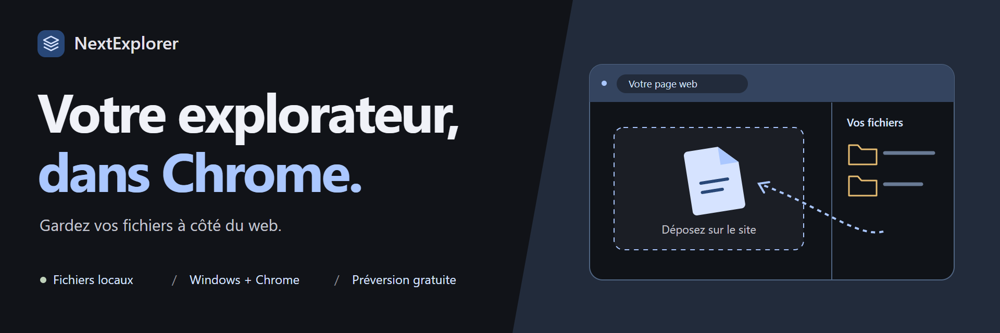
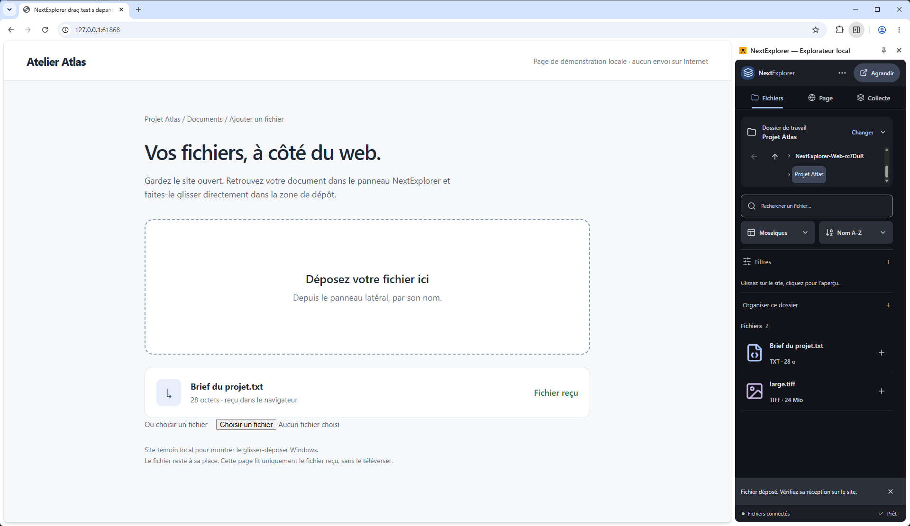
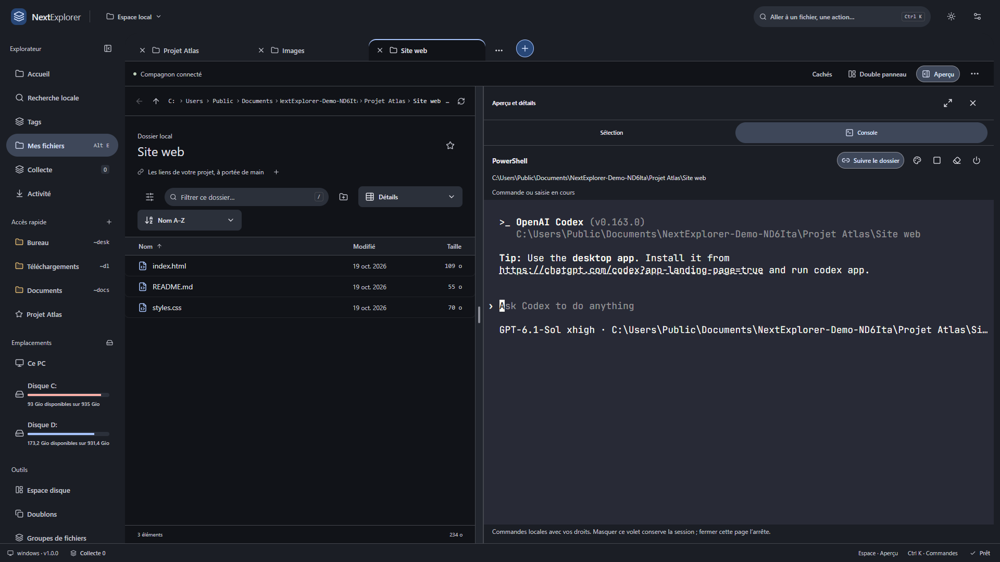
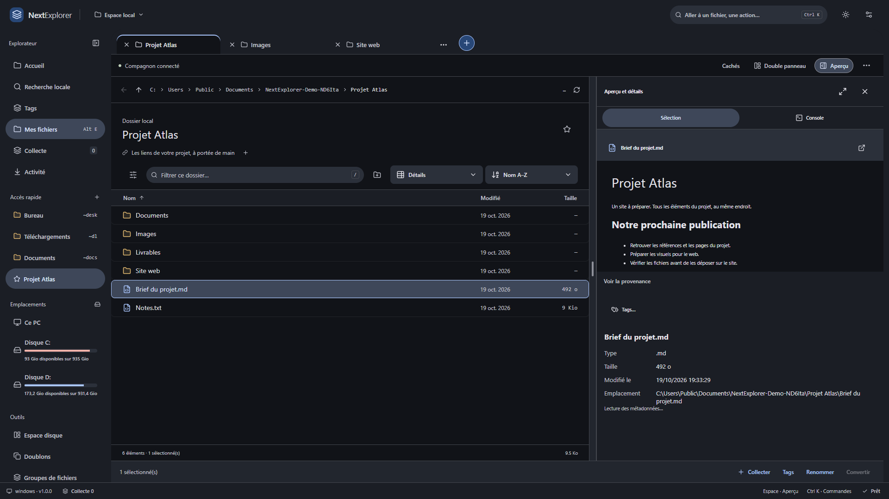
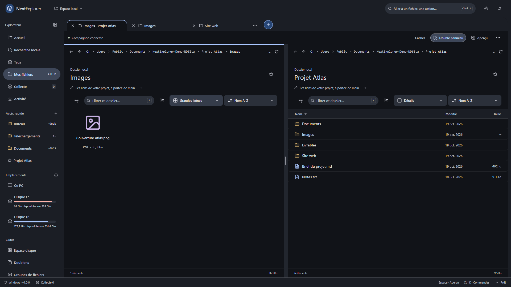
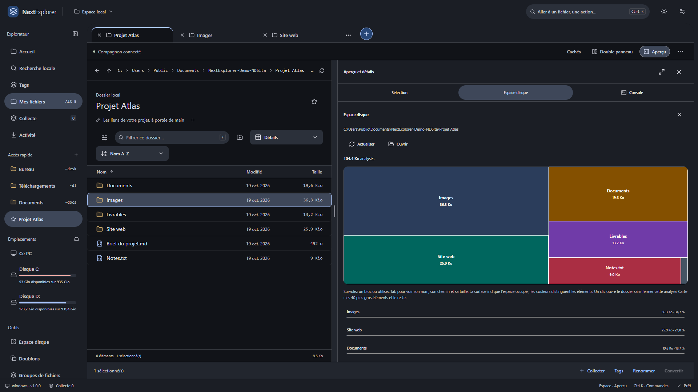
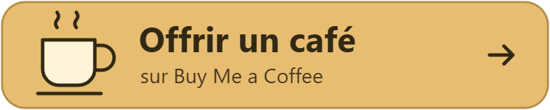

# NextExplorer

  <a href="https://github.com/Gremy44/NextExplorer-Downloads/releases"><strong>Télécharger la préversion gratuite</strong></a>
  &nbsp; · &nbsp; <a href="INSTALLATION.md">Guide d’installation</a>
  &nbsp; · &nbsp; <a href="#la-suite-du-projet">La suite du projet</a>
  &nbsp; · &nbsp; <a href="https://buymeacoffee.com/gremy_44">☕ Soutenir le projet</a>

**Un dossier à parcourir. Un document à déposer. Un projet à reprendre.**
NextExplorer réunit vos fichiers locaux et vos outils web dans Chrome :
un panneau à côté de la page, un explorateur complet quand vous avez besoin
de place, et un terminal dans le dossier de travail.

**Windows 11 x64 et Chrome · gratuit pour les usages personnels et professionnels.**
Préversion technique avec extension et compagnon Windows non signé.
Le candidat pilote **1.0.7** regroupe le socle consolidé : aperçus bornés, recherche
locale élargie, brouillons récupérables et interface compacte. L’installation
du pilote utilise le chargement manuel de l’extension, sans dépendre du Store.
Commencez avec des copies de démonstration.
[Bien démarrer](INSTALLATION.md) · [Parcours de test et retours](TESTER.md).

## Le bon fichier, directement sur le site

Gardez votre page ouverte. Retrouvez le document dans le panneau latéral,
puis **glissez son nom vers la zone de dépôt du site**. L’original reste
dans son dossier et la page reste sous vos yeux.

Joindre une pièce, publier un visuel ou déposer un livrable devient un même
parcours, avec vos dossiers à portée de main.

*Vraie fenêtre Chrome et vrai dépôt Windows sur une page témoin locale.
Cliquez sur les captures pour les ouvrir en pleine résolution.*

Le geste fonctionne fichier par fichier sur les sites compatibles. Pour
préparer un ensemble, la **collecte** réunit les fichiers de plusieurs dossiers,
les liens et les ressources du projet, avec insertion dans les formulaires
pris en charge.

## Votre terminal a déjà le bon dossier

Ouvrez **Aperçu → Console** et lancez PowerShell, Git, vos scripts ou
**Codex CLI** dans le répertoire du projet. Vos fichiers restent visibles
à côté du terminal : vous pouvez parcourir le code et consulter vos ressources
dans le même espace.

La console suit le dossier lorsque l’invite est disponible. Épinglez-la pour
rester dans un projet, ajustez sa largeur et choisissez son apparence :
**Ubuntu, Dracula, Nord, Solarized ou LCD rétro**, avec police et taille réglables.

*Codex CLI est un outil externe à installer et à configurer séparément,
avec ses propres conditions et éventuels coûts. La capture montre son démarrage,
sans requête au modèle. Les commandes utilisent vos droits Windows.*

## De la place pour vos projets

Plusieurs dossiers en **onglets**, un **double panneau ajustable**, un aperçu
qui suit la sélection et des affichages adaptés à votre façon de travailler.
Passez du panneau web à la vue complète pour retrouver vos documents,
comparer des emplacements ou préparer vos fichiers.

Un **espace hybride** garde ensemble les dossiers, la disposition, les liens,
la collecte, les pages et groupes d’onglets web ainsi que vos tâches.
Reprenez le contexte du projet ; choisissez les pages à rouvrir.
Les fichiers restent à leur emplacement.

<strong>Voir le double panneau et l’analyse de l’espace disque</strong>

### Deux emplacements, une même vue

Une source à gauche, une destination à droite. Les panneaux s’ajustent
et peuvent utiliser des affichages différents.

### Comprendre ce qui prend de la place

Consultez l’espace disponible sur les disques et analysez un dossier
dans le volet d’aperçu. La carte et les tailles restent visibles pendant
la navigation, avec les détails au survol ou au clavier.

## Les outils du quotidien, réunis

| Pour… | Vous avez… |
| --- | --- |
| **Retrouver** | Recherche textuelle locale, tags colorés, favoris, couleurs et symboles de dossiers. |
| **Organiser** | Regroupements par format, nom, date, taille ou origine ; familles de fichiers, copies identiques et images similaires. |
| **Préparer** | Copies d’images pour le web, conversions image/vidéo, préréglages et archives ZIP/7z. |
| **Consulter** | Aperçus compatibles, métadonnées, PDF, actions rapides de rotation, annotation, assemblage ou découpe. |
| **Gérer** | Copie, déplacement, renommage par lots, conflits, corbeille et annulation selon l’opération. |
| **Suivre** | Règles de rangement des téléchargements activées explicitement, activité et tâches locales autorisées. |
| **Personnaliser** | Affichages, tri, filtres, raccourcis, thèmes, largeurs et réglages exportables. |

Certains formats et traitements nécessitent des moteurs complémentaires.
Les rapprochements de fichiers ne déclenchent pas de suppression automatique.

**[Découvrir toutes les fonctions, leurs usages et leurs limites](FONCTIONNALITES.md)**

## La suite du projet

La base gratuite continue d’évoluer. Trois directions pour aller plus loin :

- **Une IA locale facultative.** Proposer un classement à partir du contenu
  des documents et des images, puis retrouver les fichiers par leur sens.
  Plus tard, aider à préparer un dossier à partir des consignes d’une page.
- **Une interface encore plus claire.** Affiner le design Material 3, alléger
  les parcours et harmoniser les outils, du petit panneau à la vue complète.
- **Davantage de formats en aperçu.** Étendre la lecture locale de documents,
  tableaux et images spécialisées à partir de notre audit de 100 formats.
  Parmi les pistes : rendu complet DOCX/ODT ou XLSX/ODS, CSV en grille,
  PSD et RAW. Les extraits Office et les images HEIC/HEIF via moteur
  facultatif ont déjà un premier périmètre de consultation.

**Ces évolutions sont prévues ou à l’étude, pas livrées dans la préversion.**
La fiabilisation de la base gratuite et de son installation vient d’abord.
Modèles, formats et besoins matériels seront validés avant annonce de disponibilité.
L’objectif reste le traitement local, sans repli cloud implicite.

Les fonctions classiques resteront utilisables sans modèle d’IA.
Une future offre Pro pourra ajouter des capacités distinctes si leur gain
est démontré. Aucun tarif ni calendrier ferme n’est annoncé.

## Essayez avec votre prochain petit projet

1. **[Téléchargez la préversion](https://github.com/Gremy44/NextExplorer-Downloads/releases)** depuis les releases officielles.
2. **[Suivez le guide d’installation](INSTALLATION.md)** pour le compagnon et l’extension Chrome.
3. Ouvrez un dossier de démonstration et retrouvez vos fichiers à côté d’une page web.

<strong>Avant de commencer : installation, formats et confidentialité</strong>

### Pourquoi une préversion technique ?

La recette complète de l’installateur sur Windows propre reste à effectuer.
Le compagnon et l’installateur ne sont pas signés : Windows peut afficher
une alerte ou bloquer le lancement. Les empreintes SHA256 sont fournies.
L’extension n’est pas encore sur le Chrome Web Store ; son chargement est manuel.

### Pourquoi un compagnon Windows ?

Le compagnon fournit l’accès aux opérations locales, au glisser-déposer
Windows et à la console. Les deux composants proviennent de la même release.
Les commandes PowerShell ne passent pas par l’annulation de l’explorateur ;
un outil interactif lancé conserve son répertoire pendant votre navigation.

### Tout est-il inclus ?

Les moteurs multimédias, d’archives et de métadonnées sont optionnels et absents
du téléchargement initial. Tous les formats et tous les sites ne sont pas
compatibles. Les aperçus servent à consulter ; ils ne remplacent pas les logiciels
d’édition. Consultez le [guide des fonctionnalités](FONCTIONNALITES.md).

### Où vont mes données ?

NextExplorer traite localement les fichiers, index et réglages, sans compte
NextExplorer ni télémétrie. Le dépôt d’un fichier peut déclencher son envoi
au site choisi ; les outils externes comme Codex ont leurs propres connexions.
[Lire la politique de confidentialité](CONFIDENTIALITE.md).

### Gratuit signifie-t-il open source ?

L’usage personnel et professionnel des versions livrées est gratuit selon
la [licence](LICENSE). Le code applicatif reste privé. Ce dépôt contient
documentation, téléchargements et retours ; les archives « Source code »
générées par GitHub correspondent à ce dépôt documentaire.
Les fonctions gratuites de la version reçue restent utilisables selon sa licence.

## Un café pour faire avancer NextExplorer

Je développe NextExplorer en indépendant. Si ce projet vous plaît ou vous rend
service, vous pouvez **m’offrir un café pour soutenir son développement**.

Votre soutien m’aide à consacrer du temps aux améliorations qui comptent :
une interface plus agréable, davantage de formats en aperçu et, à terme,
des fonctions d’IA locale utiles et facultatives.

  

**Chaque contribution est facultative. La version gratuite reste accessible
avec ou sans soutien.** Merci à celles et ceux qui donnent un coup de pouce,
partagent le projet ou prennent le temps de faire un retour.

## Construisons la suite

Une **étoile sur le dépôt** aide à faire connaître NextExplorer.
Vos retours sur un parcours ou un fichier qui résiste aident à choisir les
améliorations utiles.

**[Partager un retour ou signaler un problème](https://github.com/Gremy44/NextExplorer-Downloads/issues/new/choose)**

[Installation](INSTALLATION.md) · [Fonctionnalités](FONCTIONNALITES.md)
· [Versions](CHANGELOG.md) · [Confidentialité](CONFIDENTIALITE.md)
· [Licence](LICENSE) · [Composants tiers](THIRD_PARTY.md)

Projet de **Gremy44**. Captures réelles sur fichiers fictifs ; la bannière
est une illustration. Pour vos retours publics, retirez les documents,
commandes et chemins personnels.
