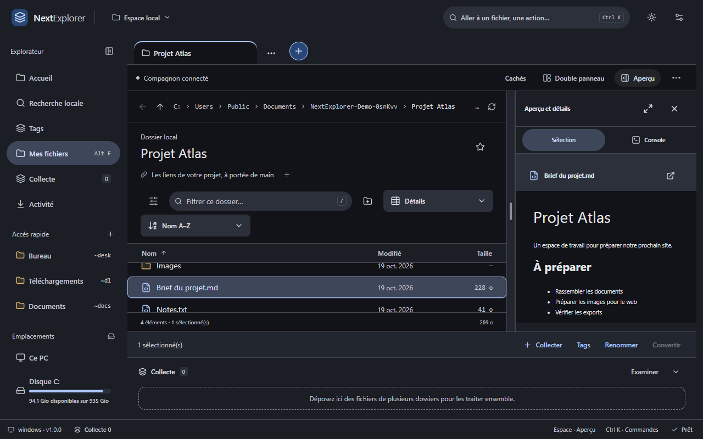
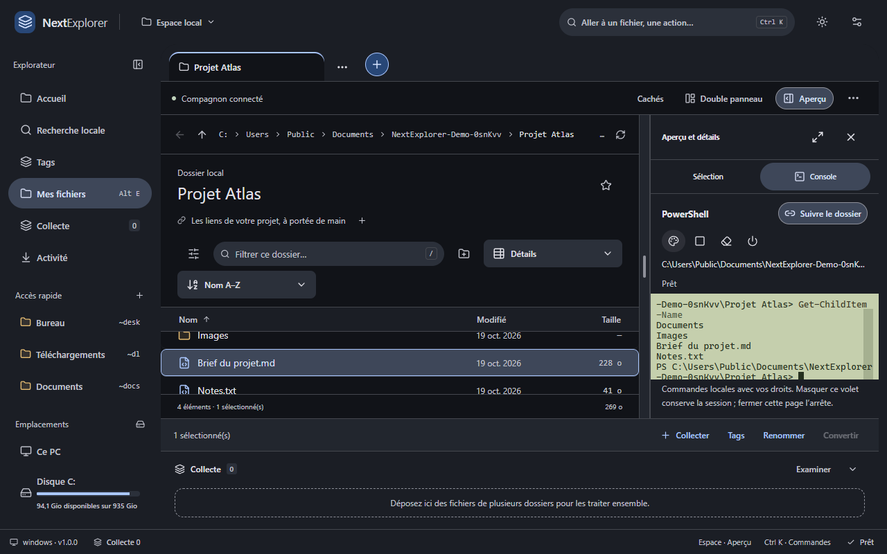

# NextExplorer

**Vos fichiers locaux et vos projets web dans un même espace.**

Extension Chrome et compagnon Windows : panneau latéral, explorateur à onglets,
double panneau, aperçus, tags, organisation, préparation de médias et console PowerShell.

## Télécharger

**[Voir les téléchargements et notes de version](https://github.com/Gremy44/NextExplorer-Downloads/releases)**

Première **préversion technique gratuite**, destinée aux essais avec des fichiers
de démonstration. La recette complète de l’installateur sur Windows propre reste
à effectuer. Le compagnon et l’installateur sont **non signés** : Windows peut
afficher une alerte ou bloquer leur lancement. Les empreintes SHA256 sont fournies.

- Cible initiale : **Windows 11 x64 et Chrome**, interface française.
- Deux composants nécessaires : extension Chrome et compagnon Windows.
- Aucun compte NextExplorer, abonnement ou modèle d’IA requis.
- Certains formats et traitements nécessitent des moteurs complémentaires,
  absents du téléchargement initial.

L’extension n’est pas encore publiée sur le Chrome Web Store. Cette préversion se
charge manuellement dans Chrome ; le [guide d’installation](INSTALLATION.md)
explique le parcours. La publication Store viendra après validation de l’identité
et de l’installation.

## Ce que vous pouvez essayer

- Navigation par chemin, onglets, double panneau ajustable, affichages et tri.
- Aperçu et métadonnées des fichiers compatibles, analyse de l’espace disque.
- Copies, déplacements, renommages, conflits et annulation sous conditions.
- Tags, espaces de travail, recherche textuelle et regroupements locaux bornés.
- Collecte de liens et fichiers pour vos projets web, insertion dans des pages compatibles.
- Préparation d’images/vidéos et archives lorsque les moteurs requis sont installés.
- Console PowerShell intégrée, suivi du dossier et thèmes de terminal.

Les commandes PowerShell s’exécutent avec vos droits Windows. Elles ne passent
pas par l’annulation des opérations de NextExplorer. Tous les formats de fichiers
et tous les sites web ne sont pas pris en charge.

## Gratuit et confidentialité

Le logiciel livré est utilisable gratuitement pour des besoins personnels ou
professionnels, selon la [licence d’utilisation](LICENSE). Le code source
applicatif reste privé ; ce dépôt public contient les téléchargements, la
documentation et les retours utilisateurs. Les archives « Source code » générées
par GitHub contiennent ce dépôt documentaire, pas les sources de l’application.

Une future offre Pro pourra ajouter des fonctions distinctes. Les fonctions
gratuites de la version reçue restent utilisables selon sa licence.

Les fichiers, index et réglages sont traités localement par NextExplorer.
Les actions de collecte ou de dépôt vers un site contactent les services choisis.
Consultez la [politique de confidentialité](CONFIDENTIALITE.md).

## Aide et retours

- [Installation, mise à jour et retrait](INSTALLATION.md).
- [Historique des versions](CHANGELOG.md).
- [Signaler un problème](https://github.com/Gremy44/NextExplorer-Downloads/issues/new/choose).
- [Composants tiers](THIRD_PARTY.md).

Éditeur du projet : **Gremy44**. Ne joignez pas de document personnel, de commande
confidentielle ou de chemin contenant votre identité dans un ticket public.
